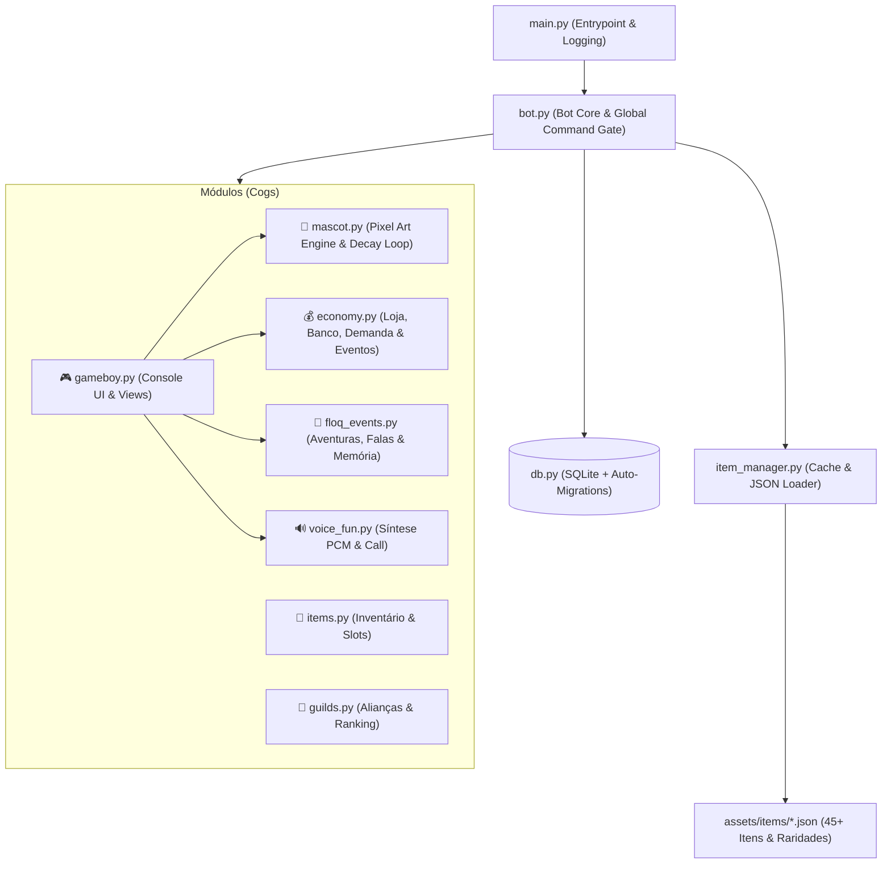

<div align="center">

# 🐾 Floq — O Mascote Virtual em Estilo Game Boy para Discord

**Um bot de RPG, Tamagotchi cooperativo e economia dinâmica inspirado no meu cachorrinho Maltês, o Floquinho.**

[](https://www.python.org/)
[](https://discordpy.readthedocs.io/)
[](https://python-pillow.org/)
[](https://www.sqlite.org/)

</div>

---

## 🐶 A História por Trás do Projeto

O **Floq** nasceu de uma ideia afetiva: imortalizar o meu cachorro **Floquinho** (um Maltês cheio de personalidade) como um mascote virtual que pudesse viver dentro de servidores do Discord, unindo os membros como uma verdadeira "matilha".

Mais do que um simples bot de comandos em texto, o objetivo técnico foi criar uma **experiência de console portátil retrô (estilo Game Boy clássico)** diretamente dentro do Discord. Ao digitar `!floq`, o usuário abre um visor interativo onde pode alimentar, brincar, vestir equipamentos no Floquinho (gerados em **pixel art procedural** em tempo real), participar de aventuras cooperativas com o servidor e até chamar o Floq para dar uns latidos no canal de voz!

---

## ✨ Destaques Técnicos (Para Recrutadores e Avaliadores)

Este projeto foi construído explorando recursos avançados do ecossistema Python e da API do Discord, sem depender de assets externos pesados:

* 🎮 **Interface Single-Entrypoint estilo Game Boy (`discord.ui`):** Em vez de dezenas de comandos soltos poluindo o chat, um *Global Gate* direciona a experiência para o comando `!floq`. Ele instancia uma `View` com `Select` menus, `Buttons` dinâmicos e `Modals` (`TextInput`), atualizando a mesma mensagem em tempo real (*in-place editing*) com visual verde DMG (`RGB 155, 188, 15`).
* 🎨 **Renderização Procedural de Pixel Art (`Pillow`):** O sprite do Floquinho (um Maltês em pixel art) não é uma imagem estática — ele é desenhado **pixel a pixel em memória (`io.BytesIO`)** a cada interação! A engine altera dinamicamente:
  * **Expressões e Clima por Humor:** Olhos, orelhas, boca, posição do rabo, cor de fundo e partículas extras mudam conforme o estado (`😊 Feliz` com corações, `😐 Neutro`, `😢 Triste` com nuvem de chuva e lágrima, ou `🌀 Caótico` em modo *zoomies*).
  * **Sistema de Equipamentos Visuais:** Itens equipados nos slots `head`, `body`, `accessory` e `weapon` são desenhados sobre o sprite do cachorro e coloridos automaticamente de acordo com a raridade do item (`common` a `legendary`).
* 🔊 **Síntese Procedural de Áudio PCM (`math` + `discord.PCMAudio`):** Quando chamado para o canal de voz, o bot **não reproduz arquivos `.mp3` gravados**. Ele sintetiza o som do latido matematicamente em Python puro (áudio estéreo 48kHz 16-bit PCM), combinando varredura de frequência senoidal descendente, envelope `sin` e ruído branco para simular a textura do latido antes de entrar na call, latir e sair correndo.
* 📈 **Economia Dinâmica & Eventos de Mercado:** Sistema completo com carteira individual, **Cofre Coletivo do Servidor**, bônus de *streak* diário progressivo, loja com rotação automática, variação de preços por **oferta e demanda** (com *decay* em background) e eventos econômicos globais automáticos (*Boom Econômico* e *Crise*).
* 🧠 **Memória Curta & Eventos Narrativos Assíncronos (`discord.ext.tasks`):** O Floq possui loops em background para mandar mensagens espontâneas no servidor de acordo com seu humor atual e conta com um sistema de **memória curta**, lembrando quem foi o último usuário que interagiu com ele (e o que fez) para mencioná-lo espontaneamente no chat.

---

## 🕹️ Preview do Console Interativo (`!floq`)

Tudo acontece dentro do visor ASCII do console, controlado por dropdowns e botões interativos:

```text
🎮 CONSOLE FLOQ
┌──────────────────────────────┐
│        FLOQ GAME             │
│                              │
│ Mascote: Floq                │
│ Nível:   12                  │
│ Humor:   😊 Feliz            │
│ Carteira: 1450 moedas        │
│                              │
│ Selecione uma opção          │
│ no menu abaixo ▼             │
└──────────────────────────────┘
[ 📺 Selecione uma tela...                  ▼ ]
[ 🎁 Daily ]  [ 💼 Trabalhar ]  [ 🐕 Latir na call ]
```

### Telas Disponíveis no Console
| Tela | Ícone | Funcionalidades |
| :--- | :---: | :--- |
| **Início** | 🏠 | Resumo do mascote, resgate de **Daily** (com bônus de sequência), **Trabalhar** e **Latir na call**. |
| **Pet** | 🐾 | Renderiza o **Floquinho em Pixel Art** em tempo real com barra de felicidade e botões para **Alimentar** e **Brincar**. |
| **Mochila** | 🎒 | Inventário paginado com todos os itens conquistados ou comprados pelo jogador. |
| **Equipamento** | ⚔️ | Seleção rápida para equipar/desequipar itens nos 4 slots (`Chapéu`, `Roupa`, `Acessório`, `Arma`). |
| **Loja** | 🏪 | Catálogo rotativo com mais de **45 itens** distribuídos em 5 raridades (⚪ Comum a 🟡 Lendário). |
| **Banco** | 🏦 | Cofre comunitário do servidor com depósito e saque via pop-up interativo (`Modal`). |
| **Guilda** | 🏰 | Painel da aliança entre servidores (até 4 servidores unidos somando o Poder dos seus mascotes). |
| **Aventura** | 🎯 | Progresso em tempo real das missões cooperativas ativas no servidor e botão para ajudar a matilha. |
| **Status** | ⚡ | Métricas detalhadas de Nível, Felicidade, Poder Total calculado e *Streak* diário. |
| **Instruções** | 📖 | Guia rápido de uso e referência de comandos administrativos. |

---

## 🌍 Funcionalidades Cooperativas e de Servidor

* 🚨 **Aventuras Coletivas (Raids):** De tempos em tempos, o Floq convoca o servidor para missões narrativas temporizadas — como *"🌳 A Floresta dos Esquilos"*, *"🌧️ O Grande Banho"* ou *"🐱 O Gato do Vizinho"*. Os membros precisam contribuir juntos até atingir a meta antes do tempo acabar para destravar moedas para todos os participantes e XP para o mascote.
* 🏰 **Alianças Multi-Servidor (Guildas):** Servidores diferentes podem formar uma Guilda (até 4 servidores) para somar o **Poder Total** de seus respectivos Floqs (`Nível × 10 + Felicidade + Bônus de Equipamentos`) e disputar o topo do `!guildranking`.
* ✨ **Itens Únicos Globais:** Alguns itens lendários possuem estoque único no banco de dados global — apenas **um servidor em todo o Discord** pode detê-los por vez.

---

## 🏗️ Arquitetura do Projeto



### Estrutura de Diretórios

```bash
discord-bot/
├── assets/
│   └── items/
│       ├── armor.json          # Equipamentos adicionais
│       └── floq_items.json     # Catálogo principal (45 itens de 5 raridades)
├── cogs/
│   ├── gameboy.py              # Console interativo (!floq) com Views, Selects e Modals
│   ├── mascot.py               # Gerador de Pixel Art procedural (Pillow) e loop de humor
│   ├── floq_events.py          # Aventuras cooperativas, falas espontâneas e memória curta
│   ├── economy.py              # Economia, loja rotativa, oferta/demanda e eventos de mercado
│   ├── items.py                # Gerenciamento de inventário e equipamentos
│   ├── guilds.py               # Sistema de guildas entre servidores e ranking de poder
│   └── voice_fun.py            # Síntese de áudio PCM procedural para latidos em canais de voz
├── config.py                   # Carregamento de variáveis de ambiente (.env)
├── db.py                       # Camada de persistência SQLite e migrações automáticas
├── item_manager.py             # Sincronização de itens JSON com o banco e cache em memória
├── bot.py                      # Configuração de Intents, carregamento de Cogs e Global Check
├── main.py                     # Inicialização assíncrona e configuração de logs
└── requirements.txt            # Dependências do projeto
```

---

## 🚀 Como Executar Localmente

### Pré-requisitos
* **Python 3.10+**
* Uma aplicação/bot criada no [Discord Developer Portal](https://discord.com/developers/applications) com a intent **Message Content Intent** ativada.
* *(Opcional para voz)* `PyNaCl` e `libopus` instalados no sistema para o recurso de latir na call.

### Passo a Passo

1. **Clone o repositório:**
   ```bash
   git clone https://github.com/SEU-USUARIO/discord-bot.git
   cd discord-bot
   ```

2. **Crie e ative um ambiente virtual:**
   ```bash
   python -m venv venv
   source venv/bin/activate  # Linux/macOS
   # ou: venv\Scripts\activate (Windows)
   ```

3. **Instale as dependências:**
   ```bash
   pip install -r requirements.txt
   ```

4. **Configure as variáveis de ambiente:**
   Crie um arquivo `.env` na raiz do projeto:
   ```env
   BOT_TOKEN=seu_token_do_discord_aqui
   BOT_PREFIX=!
   DATABASE_PATH=data/database.sqlite
   DAILY_REWARD=100
   DAILY_COOLDOWN_HOURS=24
   ```

5. **Inicie o bot:**
   ```bash
   python main.py
   ```
   > O banco de dados SQLite (`data/database.sqlite`) e todo o catálogo de itens (`assets/items/*.json`) são inicializados e migrados automaticamente na primeira execução!

---

## 🛠️ Comandos Principais

A experiência completa para os membros acontece pelo console:
* **`!floq`** *(aliases: `!console`, `!menu`)* — Abre o console interativo do Floq.

Comandos administrativos / de configuração do servidor:
* **`!setchannel`** — Define o canal atual para receber mensagens espontâneas e aventuras coletivas do Floq *(requer permissão de Gerenciar Canais)*.
* **`!guildcreate <nome>`** — Cria uma nova guilda (aliança) para o servidor *(requer Gerenciar Servidor)*.
* **`!guildjoin <nome>`** — Junta o servidor a uma guilda existente *(requer Gerenciar Servidor)*.
* **`!guildranking`** — Exibe o ranking global das guildas mais fortes.
* **`!shoprefresh`** — Força a rotação imediata do catálogo da loja *(requer Gerenciar Servidor)*.

---

<div align="center">
  Feito com ❤️ e muitos petiscos em homenagem ao <b>Floquinho</b> 🐾
</div>
